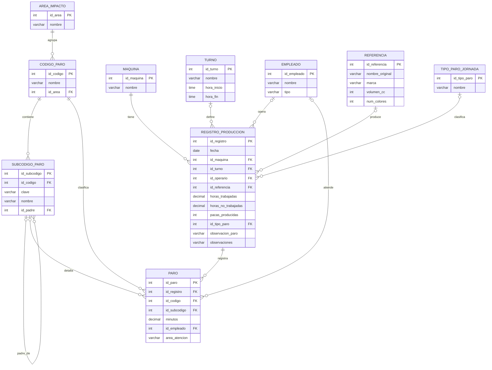

# 04. Modelo relacional (lógico)

Derivado del modelo conceptual (MER). Notación: **PK** = llave primaria, *FK* = llave foránea.
Los nombres y tipos finales de cada columna se fijan en el diccionario de datos (06) y en el DDL.

## Diagrama

## Relaciones (esquema)

- AREA_IMPACTO(**id_area**, nombre)
- CODIGO_PARO(**id_codigo**, nombre, *id_area*)
- SUBCODIGO_PARO(**id_subcodigo**, *id_codigo*, clave, nombre, *id_padre*)
  - UNIQUE(id_codigo, clave) y UNIQUE(id_codigo, id_subcodigo)
- MAQUINA(**id_maquina**, nombre)
- TURNO(**id_turno**, nombre, hora_inicio, hora_fin)
- EMPLEADO(**id_empleado**, nombre, tipo)
- REFERENCIA(**id_referencia**, nombre_original, marca, volumen_cc, num_colores)
- TIPO_PARO_JORNADA(**id_tipo_paro**, nombre)
- REGISTRO_PRODUCCION(**id_registro**, fecha, *id_maquina*, *id_turno*, *id_operario*, *id_referencia*, horas_trabajadas, horas_no_trabajadas, pacas_producidas, *id_tipo_paro*, observacion_paro, observaciones)
- PARO(**id_paro**, *id_registro*, *id_codigo*, *id_subcodigo*, minutos, *id_empleado*, area_atencion)
  - FK compuesta (id_codigo, id_subcodigo) → SUBCODIGO_PARO(id_codigo, id_subcodigo)

## Cómo se hace cumplir cada regla de negocio

| Regla | Mecanismo |
|---|---|
| Todo registro tiene máquina y fecha | NOT NULL + FK a MAQUINA |
| Un registro tiene 0..N paros | FK PARO.id_registro (ON DELETE CASCADE) |
| Duración de un paro > 0 | CHECK (minutos > 0) |
| El subcódigo pertenece al código del paro | FK compuesta (id_codigo, id_subcodigo) |
| Solo los códigos 01, 03 y 05 tienen subcódigo | El catálogo SUBCODIGO_PARO solo contiene subcódigos de esos códigos |
| Cada código pertenece a un área de impacto | FK CODIGO_PARO.id_area NOT NULL |
| Horas y pacas no negativas | CHECK (>= 0) |
| area_atencion válida | CHECK (area_atencion IN ('OPERARIOS','MANTENIMIENTO')) |
| Horas de paro <= horas trabajadas | No se puede con un CHECK (involucra varias filas). Se valida con una vista de control o un trigger. |
| Mes, año, horas de paro y productividad | No se almacenan: se calculan en vistas y consultas |

## Ajustes respecto al planteamiento inicial (derivados del análisis de los datos)

1. **TURNO es opcional en el registro.** Hay 3.912 filas sin turno y 336 con "No aplica" (días sin programación). Se admite NULL en lugar de inventar un turno ficticio.
2. **area_atencion vive en PARO, no en EMPLEADO.** En el Excel, "Área involucrada" se registra incluso cuando no hay persona (7.940 filas con área y solo 1.767 con persona), así que es un dato del paro y no se puede derivar del empleado.
3. **No hay UNIQUE(id_registro, id_codigo) en PARO.** El procedimiento P-MTO-22 permite guardar varios subcódigos dentro del mismo registro (botón "Ingreso subcódigo"), por lo que un mismo código puede aparecer más de una vez.
4. **Supuesto por confirmar:** el código 18 (Desinfección) no aparece en el catálogo de áreas del Excel. Se propone asignarlo a "Paro programado".
5. **Corrección del catálogo:** en `TABLA CODIGOS`, el subcódigo "1.4.3 Sensor" rompe el patrón de letras; se normaliza como 1.4.C.